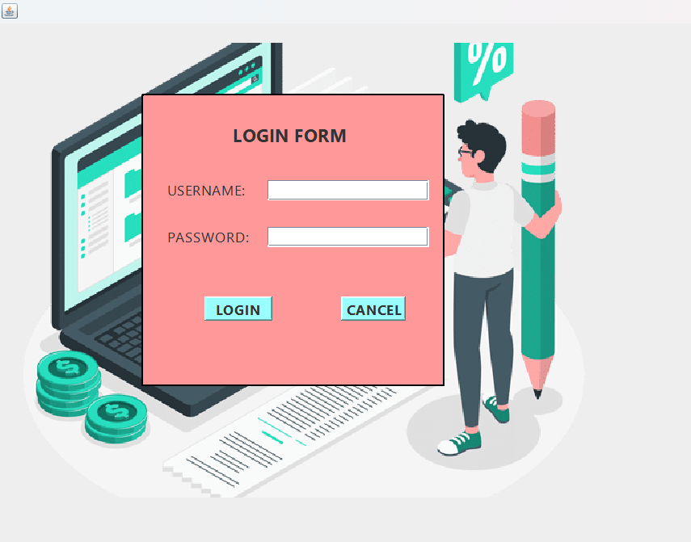
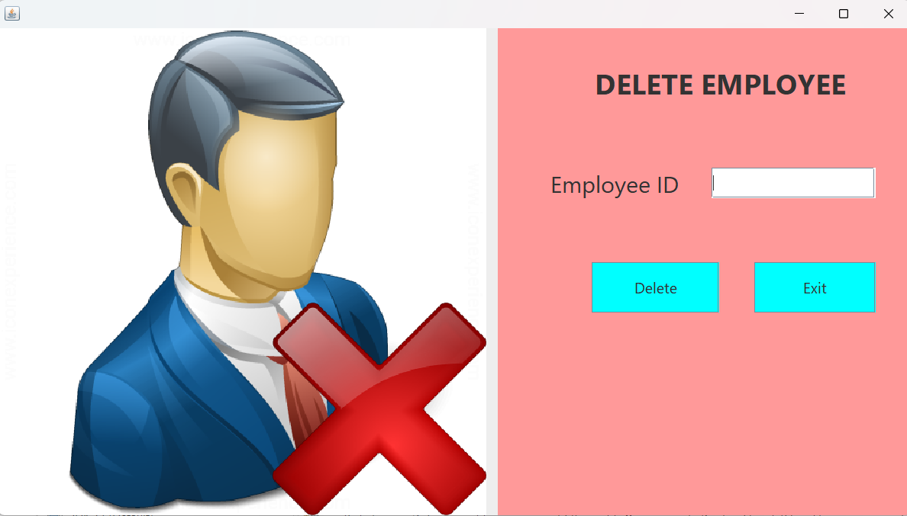

# Payroll Management System

A Java-based desktop application designed to manage employee payroll operations through a graphical user interface.

## Features

- User login
- Employee management
- Add and delete employee records
- Search and update employee details
- Leave application management
- Employee contact information
- Database connectivity using MySQL

## Technologies Used

- Java
- Java Swing
- MySQL
- JDBC
- Apache NetBeans IDE
- Apache Ant

## Project Structure

- `src/` – Java source files and Swing forms
- `nbproject/` – NetBeans project configuration
- `build.xml` – Apache Ant build configuration
- `manifest.mf` – Application manifest

## Prerequisites

- JDK 17 or compatible Java version
- Apache NetBeans IDE
- MySQL Server
- MySQL Connector/J

## How to Run

1. Clone or download this repository.
2. Open the project in Apache NetBeans.
3. Configure the MySQL database and connection properties locally.
4. Add the required MySQL Connector/J and AbsoluteLayout libraries.
5. Build and run the project from NetBeans.

## Author

Developed as a Java desktop application project.

## Application Screenshots

### Login Page

### Main Menu

### Add Employee

### Update Employee

### Search Employee

### Delete Employee

### Apply Leave

### Help Desk

